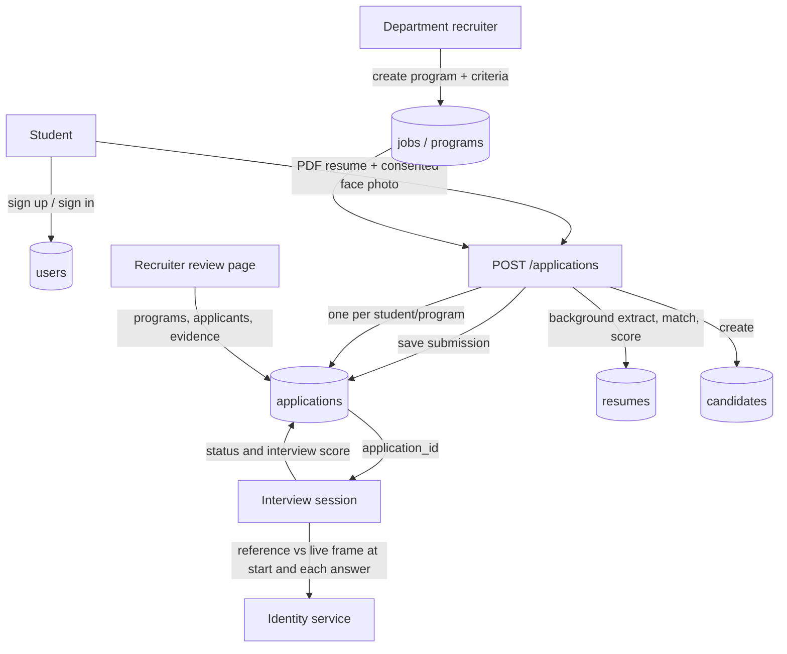

# Higher studies application and interview flow

## Purpose and current scope

This feature adapts the existing interview pipeline to department and program admissions. A department publishes a program with a description and evaluation criteria. A student selects a program, uploads one PDF resume, and submits a face reference after explicit consent. The API validates and stores the submission, returns an application receipt, and scores the resume in a server-side background task. The task continues when the student closes the page; recruiters see the score and evidence after processing finishes. Students see application status, not marks. The student can then start an interview from that application. The same private face reference is used at interview start and checked with a fresh camera frame at each answer. Recruiters review applications, evidence and identity status.

This is a working local prototype. Scores assist review; they are not an admissions decision. Face comparison does not establish liveness or identity with production-grade assurance.

## Domain mapping

| Admissions concept | Current implementation |
| --- | --- |
| Program / department opportunity | `JobModel` (`jobs` table); `required_skills` stores the criteria list |
| Student account | `UserModel` with candidate role |
| Student profile | `CandidateModel` (`candidates` table), linked to the user |
| Submitted resume | `ResumeModel` (`resumes` table) plus private PDF path |
| One student's application to one program | `ApplicationModel` (`applications` table), unique candidate/program pair |
| Face enrollment | Per-application private JPEG path plus consent timestamp/version on the application |
| Interview | Existing registry and `InterviewSessionModel`; the session's `job_id` points to the program |



## User journeys and local pages

1. The root page presents the two user entry points: `/recruiter` and `/student`.
2. A recruiter signs in at `/recruiter`, creates an opportunity with its criteria, reviews applications in score order, inspects extracted keywords and criterion evidence, and explicitly shortlists candidates. Deleting an empty opportunity removes it. If applications or interview history exist, the delete action closes the opportunity and retains its records.
3. A student opens `/student`, creates/signs in to a candidate account, selects an open opportunity, uploads a PDF, captures a face reference, accepts the consent, and submits. The API stores the application and schedules server-side resume scoring against that program's criteria. The student can leave the page; scoring continues while the backend is running. Only recruiter responses contain numerical marks, scoring method, extracted skills, and criterion evidence.
4. The student sees application status in the student portal. The interview link is enabled after recruiter shortlisting. `/interview-ui?application_id=APP_ID` starts an application-bound session, checks the enrolled identity, and only then allows answers. Interview identity/status and final score are written back to the same application row.

## HTTP contract

| Method and path | Access | Behavior |
| --- | --- | --- |
| `GET /programs` | Public | List open programs and their descriptions/criteria |
| `GET /programs/manage` | Recruiter/admin | List open and closed opportunities |
| `GET /programs/{program_id}` | Public | Read an open program |
| `POST /programs` | Recruiter/admin | Create an open program; JSON fields: `title`, `department`, `description`, `criteria` |
| `DELETE /programs/{program_id}` | Recruiter/admin | Delete an empty opportunity, otherwise close it and preserve associated history |
| `POST /applications` | Candidate | Multipart `program_id`, `full_name`, `biometric_consent`, `resume`, `face_reference`; validates and persists an application, then schedules server-side scoring |
| `GET /applications/mine` | Candidate | List owned applications with status and identity state; omits resume and interview marks |
| `GET /applications` | Recruiter/admin | List applications, optionally filtered by `program_id` |
| `POST /applications/{application_id}/shortlist` | Recruiter/admin | Mark an eligible application shortlisted and enable its application-bound interview |
| `GET /applications/{application_id}` | Owner, recruiter or admin | Student owners receive status and program data; recruiter/admin receive scoring and evidence fields |
| `POST /interview/start` | Authenticated | Pass `application_id` and a unique `session_id`; server derives candidate and criteria from application |
| `GET /interview/{session_id}` | Session owner | Read the current interview state/question |
| `POST /identity/{session_id}/check` | Session owner | Verify the enrolled reference against a fresh live camera frame before showing the first question |
| `POST /interview/{session_id}/check` | Session owner | Submit a live camera frame for identity verification |
| `POST /interview/{session_id}/answer/audio` | Session owner | Multipart audio and live frame; transcribes, verifies again and evaluates answer |
| `POST /interview/{session_id}/answer` | Session owner | Text answer plus live frame for the same verification gate |
| `POST /interview/{session_id}/finish` | Session owner | Finish and persist outcome |

The application interview start does not trust a client-supplied candidate ID, criteria, or reference image. The application record supplies those values. Each answer path requires a fresh live frame for candidate-role users. Audio frames and audio files are written to private storage temporarily and removed after processing.

## Resume scoring

After submission, a FastAPI background task parses the PDF and first attempts criterion-by-criterion analysis with the configured NVIDIA LLM. `EvidenceValidator` removes any model quote not found verbatim in the resume and caps unsupported assessments. `LLMScoreAdapter` combines criterion scores into an overall compatibility score. If provider setup or analysis fails, the system records `scoring_method: keyword_evidence` and falls back to `CompetencyMatcher`, which finds known keywords or tokens derived from custom criterion names and supplies resume excerpts. Criteria have equal weights in this application flow. Extracted skills and evidence are included in recruiter responses; candidate application, profile, interview, and recommendation responses omit numerical marks. Applications are ordered by compatibility, but shortlisting is a separate human action.

## Interview question plan

Application interviews start with a short introduction question that is not scored. They then take target competencies directly from the selected program's evaluation criteria. The first pass is horizontal: ask one foundational question per criterion in the program's configured order. The second pass is vertical: return to each criterion and ask for deeper evidence, such as the candidate's decisions, trade-offs, validation, results, and lessons. Follow-up prompts receive the answer already given. Recovery questions stay on the current criterion, and an LLM-generated question is rejected if it changes the target criterion. If question generation is unavailable, a criterion-specific deterministic prompt is used. The interview ends when the plan has sufficient evidence for each criterion or reaches the 15-turn ceiling.

The AI score is not a validated admissions decision. A resume can mention a term without demonstrating ability; the lexical fallback misses synonyms/context; scanned/image-only PDFs are not OCR'd; and the model can still make imperfect judgments even when its quoted evidence is checked. Departments must review criteria and make decisions manually. Do not use the score as an automatic reject/admit threshold.

## Biometric data and privacy

- The browser asks for explicit consent and the API rejects submissions without consent. `biometric_consent_at` and `biometric_consent_version` are stored with the application.
- The face reference and resume live below `data/storage/identity/{candidate_id}/` and `data/storage/resumes/{candidate_id}/`, not in the static web root. The database stores private file paths, not image bytes. No public face-file endpoint is added.
- The interview identity check compares the application's enrolled reference with a newly captured camera frame. A missing application reference blocks interview start. Identity status is stored separately from the resume score.
- The current repository has retention-day settings, but no verified purge job for these new application face references. Therefore no deletion deadline is currently enforced by this feature. Before real applicants are enrolled, the institution must configure and implement retention/deletion, secure backups, TLS, encrypted storage, access auditing, notice/consent language, and an appeal/manual review path.
- Current comparison is not liveness detection. A photo replay or poor camera conditions may defeat or frustrate verification. Never represent the local check as definitive identity proof.
- A failure before database commit removes the newly written resume and reference files. Interview answer media is transient and removed after processing; crash cleanup is not guaranteed without an operational sweep.

## Database and migration

The application model is in `backend/app/database/models.py`. Migration `9af13b6c2d41_add_program_applications.py` creates `applications`, its uniqueness constraint, foreign keys and indexes. Startup currently calls SQLAlchemy `Base.metadata.create_all`, which creates absent tables but does not upgrade existing table shapes or record an Alembic revision. Apply and verify migrations through the project's deployment migration procedure before deploying to an existing shared database; do not assume `create_all` replaces Alembic. The local Alembic revision may predate this feature and must be checked with `alembic current`/`alembic history` before migration in a persistent environment.

## Local run

From the repository root, install requirements and start the API:

```powershell
.\.venv\Scripts\python.exe -m pip install -r backend\requirements.txt
.\.venv\Scripts\python.exe -m uvicorn app.main:app --app-dir backend --reload --host 127.0.0.1 --port 8000
```

If creating a local recruiter login, provision it with `scripts\create_recruiter.py --email recruiter@company.com`; it prompts for a 12+ character password without printing it. Candidate accounts self-register on `/apply`. The public registration API only permits the candidate role and does not accept a candidate ID. Required local face model files and configured LLM/STT providers determine whether all interview steps are available. Open:

- Portal home (two entry points): `http://localhost:8000/`
- Recruiter workspace: `http://localhost:8000/recruiter`
- Student portal: `http://localhost:8000/student`
- API docs: `http://localhost:8000/docs`

The application page supports candidate account signup/sign-in. The recruiter page requires a recruiter/admin account. The local provisioner creates a recruiter; it does not contain a shipped demo password. Never use default credentials in a deployed environment.

## Follow-up work before production

1. Use a dedicated `Program` table/API instead of overloading `JobModel`; add admissions cycles, deadlines, capacity, and program owners.
2. Add explicit application state transitions, withdrawal/deletion, document replacement, and reviewer decision/audit endpoints.
3. Add configurable retention with a tested scheduled purge covering originals, derivatives, caches and backups; encryption and access logging for identity media.
4. Replace lexical scoring with a validated, explainable rubric while preserving human review and accessibility accommodations.
5. Add robust liveness/anti-spoof evaluation with a manual fallback; validate false-match and false-reject rates across representative users and devices.
6. Persist every interview turn and score against the application, add async job polling/retry UX, and define transcript/audio retention.
7. Add end-to-end acceptance coverage for candidate ownership, duplicate application, malformed files, consent, score evidence, identity pass/fail, and transcription-provider errors.
